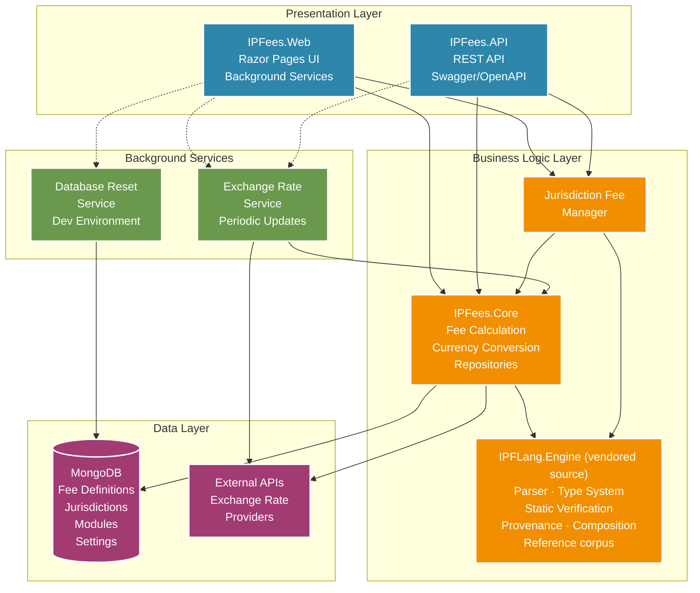

# IPFees Technical Architecture



## Architecture Overview

The IPFees system is built using a clean, layered architecture with clear separation of concerns. The actual implementation consists of four main .NET projects working together to provide IP fee calculation services.

### Presentation Layer

#### IPFees.Web
- **Technology**: ASP.NET Core Razor Pages with Bootstrap 5
- **Purpose**: Primary user interface for interactive fee calculations
- **Responsibilities**:
  - User interface for fee calculations
  - Jurisdiction and module management
  - Settings configuration
  - Hosts background services (ExchangeRateService, DatabaseResetService)
- **Key Features**: Responsive design, real-time calculations, administrative interface

#### IPFees.API
- **Technology**: ASP.NET Core Web API with Swagger/OpenAPI
- **Purpose**: RESTful API for external integrations and automation
- **Responsibilities**:
  - REST endpoints for fee calculations
  - API key authentication
  - Bulk calculation support
  - External system integration
- **Endpoints**: `/api/v1/Fee`, `/api/v1/Jurisdiction`, `/api/v1/Currency`

### Business Logic Layer

#### IPFees.Core
- **Purpose**: Core business logic and domain models
- **Key Components**:
  - `FeeCalculation`: Fee calculation orchestration
  - `CurrencyConversion`: Multi-currency support with exchange rate fetching
  - `Repository`: Data access abstractions (Fee, Jurisdiction, Module, Settings)
  - `FeeManager`: Jurisdiction-specific fee management
  - `Model`: Domain entities (FeeDoc, JurisdictionDoc, ModuleDoc)
  - `Data`: MongoDB data context
- **Dependencies**: IPFLang.Engine (project reference), MongoDB.Driver

#### IPFLang.Engine (vendored source, `src/IPFLang.Engine`)
- **Purpose**: The fee calculation language, its engine and the reference corpus, carried as
  source so schedules and analyses are versioned with the application
- **Upstream**: [github.com/vbocan/IPFLang](https://github.com/vbocan/IPFLang), GPL-3.0; the
  imported commit and the local changes are listed in `src/IPFLang.Engine/VENDORED.md`
- **Key Components**:
  - `Parser`: IPFLang syntax and semantic analysis
  - `Types`: Currency-aware type system over the 161 active ISO 4217 currencies
  - `Analysis`: Static completeness and monotonicity verification
  - `Provenance`: Execution traces and counterfactual analysis
  - `Composition`: Jurisdiction inheritance and override resolution
  - `Corpus`: The 119 production jurisdiction schedules, embedded in the assembly
- **Note**: Has **no external dependencies** of its own
- **Relationship**: IPFees does not implement a DSL. It stores IPFLang scripts, composes
  them, executes them, and surfaces the engine's static analysis to people who never see
  the language. The engine is described in the IEEE OJCS article cited in `CITATION.cff`.

#### Jurisdiction Fee Manager
- **Purpose**: Manages jurisdiction-specific fee calculations
- **Integration**: Bridges Core and Calculator components
- **Responsibilities**: Coordinates fee calculation workflow across jurisdictions

### Data Layer

#### MongoDB
- **Technology**: MongoDB 8.0+ document database
- **Collections**:
  - `fees`: Fee definitions with DSL source code
  - `jurisdictions`: Jurisdiction metadata and configuration
  - `modules`: Shared input declarations, applied through IPFLang jurisdiction composition
  - `serviceSettings`: System configuration
- **Note**: GridFS is **not currently implemented** despite architecture references
- **Access Pattern**: Repository pattern through IPFees.Core

#### External APIs
- **Exchange Rate Providers**: Multi-provider support for currency conversion
- **Fallback Mechanism**: Intelligent provider switching for resilience
- **Caching**: In-memory caching with periodic background updates

### Background Services (Hosted Services)

#### ExchangeRateService
- **Purpose**: Periodic currency exchange rate updates
- **Pattern**: .NET BackgroundService with periodic execution
- **Frequency**: Configurable update intervals
- **Providers**: Supports multiple exchange rate API providers

#### DatabaseResetService
- **Purpose**: Returns the database to the reference corpus at start-up and every six hours
- **Use Case**: Keeps the public instance a sandbox: fee definitions, modules and jurisdictions a visitor added are removed, reference schedules a visitor edited are put back, and service fee levels return to their defaults
- **Environment**: Every deployment of the web front end

## Actual Project Dependencies

```
IPFees.Web
  └── IPFees.Core
      └── IPFLang.Engine  [project reference, no dependencies of its own]

IPFees.API
  └── IPFees.Core
      └── IPFLang.Engine  [project reference, no dependencies of its own]

Test Projects:
  - IPFees.Core.Tests          repositories, validation, verification, corpus properties
  - IPFLang.Engine.Tests       the engine's own suite
  - IPFees.Performance.Tests   BenchmarkDotNet suite
```

## Key Architectural Benefits

1. **Clean Separation**: The engine is its own project with no dependencies, and the platform reaches it only through its public API
2. **Modular Design**: Each project has a single, well-defined responsibility
3. **Dependency Management**: Clear dependency hierarchy prevents circular references
4. **Testability**: Each layer can be tested independently (unit, integration, performance tests)
5. **Maintainability**: DSL changes are isolated to Calculator project
6. **Extensibility**: New jurisdictions added through database configuration, not code changes
7. **API-First**: Both Web and API share the same business logic through Core

## Technology Stack Summary

- **Framework**: .NET 10.0, ASP.NET Core
- **Frontend**: Razor Pages, Bootstrap 5, jQuery
- **Database**: MongoDB 8.0+ with official C# driver
- **DSL Engine**: Custom lexer/parser/evaluator
- **API**: RESTful with Swagger/OpenAPI documentation
- **Testing**: xUnit, BenchmarkDotNet, Testcontainers
- **Containerization**: Docker & Docker Compose
- **Logging**: Serilog